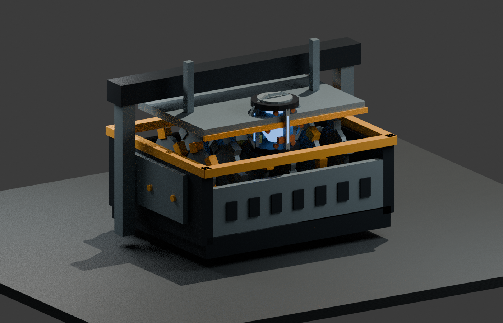
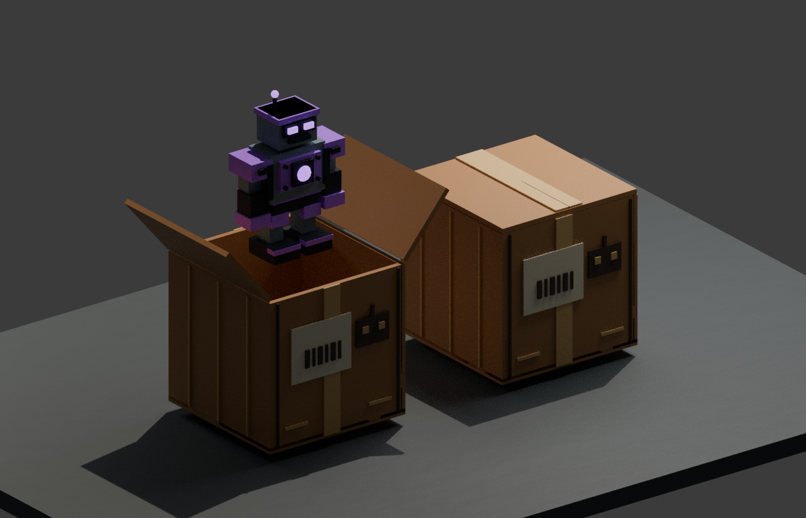

# v0.7 — overhead carrying, scrap shredder and mystery robot delivery

Recover parts or sealed robot boxes from the scrapyard and carry them above
your head. Scrap is visibly processed by a twin-shaft shredder. Cardboard boxes
open on a reserved platform and reveal one ready-made income-producing robot.
All custom in-game text is English.

## Carry presentation

The pose blends raised shoulders and bent elbows/wrists over normal animations.
R6 and R15 joint names are supported. Nearby players see each other's pose.
Walk/jump animations continue underneath; dropping or depositing blends the arms
back. The item carrier is positioned relative to the actual avatar's head.
Very unusual avatar packages still need fitting checks in Studio.

## Scrap shredder

The machine has two counter-rotating shafts with toothed cutting discs, an open
hopper, hazard rim, bearing blocks, grille, press plate and pistons. On accepted
scrap delivery the visual part travels into the hopper, jitters, shrinks and
fades as sparks and small metal offcuts fly out. The press pumps and a warm work
glow flashes during processing. All moving machine/effect geometry is cosmetic
and cannot damage or push characters.

The normal scrap recipe and income transaction remains server-controlled at
acceptance. Visual playback does not postpone or authorize the scrap award.

## Sealed robot boxes

- **14 found boxes**, two per district, placed outside the clear haul road.
- One box holds one complete robot. It needs **one free platform** and never
  consumes a partial scrap project, even of the same rarity.
- Result is drawn once on the server at spawn and is hidden during transport.
  Dropping/resetting keeps the same result. Replacement spawn: **35 seconds**.
- Use **E / Recover box**, carry it home, then **E / Deliver scrap or box**.
- At delivery, the reserved platform shows a shaking carton. The tape splits,
  lid flaps open and a light/particle burst builds anticipation.
- After **3.8 seconds**, the robot is revealed with a short scale/rise effect.
  Its ordinary configured passive income starts at that moment.
- Full capacity, a foreign workshop, a dead character or excessive distance
  rejects delivery and preserves the box. Leaving invalidates pending rewards.

The stage's tier has 70% weight, previous tier 20%, next tier 9% and two tiers
higher 1%, clamped at the ends. For example, a Common-area box yields Common
90%, Uncommon 9%, Rare 1%. No money or Robux purchase is involved. Four total
robot platforms and session-only progress apply to crafted and found robots.

## Runtime budget and validation

Each carried carton uses 46 parts including its root/rig/halo. Each crusher adds
105 structural/moving parts plus its small effect anchor. Effects activate
within 140 studs; one scrap intake per workshop is retained, with at most eight
small offcuts. The server spawns no physical debris. Sparks are brief bursts;
lights cast no shadows. Distant effects are culled and streaming releases local
animation state. These are implementation limits, not measured FPS guarantees.

Automated tests cover fixed crate results, head-relative carry height, stale
pickup callbacks, respawn, R6/R15 pose lifecycle, slot reservation, income timing,
replay protection, rejected deliveries and account/owner cleanup. Shared checks
cover box accessibility, blade dimensions and presentation curves. All source
compiles and binary/XML place builds are verified. Roblox Studio is unavailable
in this cloud environment: actual rig fitting, animation timing, multiplayer
visuals and mobile performance still need a Windows Studio playtest.

## Asset previews

These are Blender renders of the shared geometry, **not Studio screenshots**.
The open-box image uses a staged robot pose to illustrate the contents. In game,
the neutral box is replaced by the real robot at reveal. Lighting, animation,
particles and avatar posing require an actual playtest.
