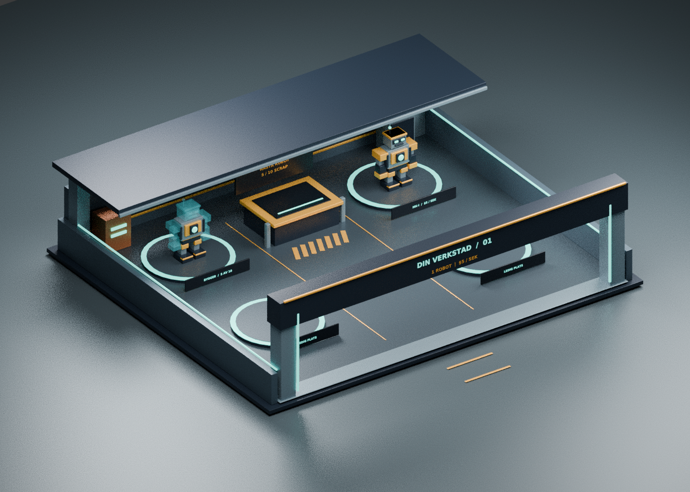

# Verkstäder och robotar – designunderlag

## Granskade kodreferenser

Två öppna Roblox-tycoon-projekt har granskats via GitHub. De används som underlag för vanliga spelmönster. Ingen av deras kod, modeller eller texturer ingår i det här bygget.

- [Tycoon Creator](https://github.com/ivadsiulsgames/tycooncreator/tree/4dc8ca7a9bd073da5c774097643060cac57b58ae): `CashGuiServiceClient.lua`, `Dropper.lua` och `SellPart.lua`. Visar separat penga-HUD, produktion med ägare och intervall, samt insamling som kopplas till rätt spelare. Vårt bygge visar både saldo och inkomsttakt och låter färdiga robotar producera direkt utan en mängd fysiska pengadelar.
- [Roblox Studio Tycoon-serien](https://github.com/B-Ricey763/Roblox-Studio-Tycoon/tree/b09783d092420a81665193a4b6649c7e4d5f60e0): `Video 13/Tycoon.lua` och `Video 6/Components/Bank.lua`/`Collector.lua`. Visar spelarägda tycoon-instansers spawn, upptagna platser, insamlingsstation och ägarkontroll. Vårt bygge använder namngivna verkstäder, en tydlig inlämningsmaskin och serverkontrollerad ekonomi.

Detta är kodgranskning, inte speltest eller visuell granskning av deras färdiga baser.

## Referenser som inte kunde granskas

Officiella sidor för **Steal a Brainrot** och **Grow a Garden** försöktes hämtas, men miljöns proxy nekade anslutningen till `www.roblox.com` med HTTP 403. Inga skärmbilder eller modeller från dessa spel har hämtats eller använts. Roblox-webbåtkomst har sparats som ett konfigurationsutkast; sparandet aktiverar inte åtkomsten i sig.

## Egen visuell riktning

- En återvinningsverkstad med öppen front, rejäla portstolpar, metallgolv och ett bakre tak som lämnar större delen av kameravyn öppen.
- Mörk stålpalett med varm orange maskinkant och olika accentfärger mellan baserna.
- En central gata, numrerade portar och ägarnamn som gör hemvägen begriplig.
- Fyra tydliga robotplattformar, en inlämningsmaskin och progressmätare.
- Scrap Bot MK-I byggs synligt i tio steg: fötter, underben, höft, kropp, reaktor, vänster arm, höger arm, huvud, ansikte och slutdetaljer.
- Framtida delar visas som en genomskinlig ritning. Färdiga robotar har en pulserande reaktor och en skylt med sin inkomst.

All geometri skapas från egna primitiva Roblox-delar i `BaseBlueprint.luau` och `RobotBlueprint.luau`. Det finns inga externa asset-ID:n eller Toolbox-modeller.

Bilden är en Blender-rendering av samma grundgeometri, med ett exempel på en färdig och en halvfärdig robot. Den är **inte en skärmbild från Roblox Studio**. Ljus, material, text och kamera kan se annorlunda ut i spelet.
