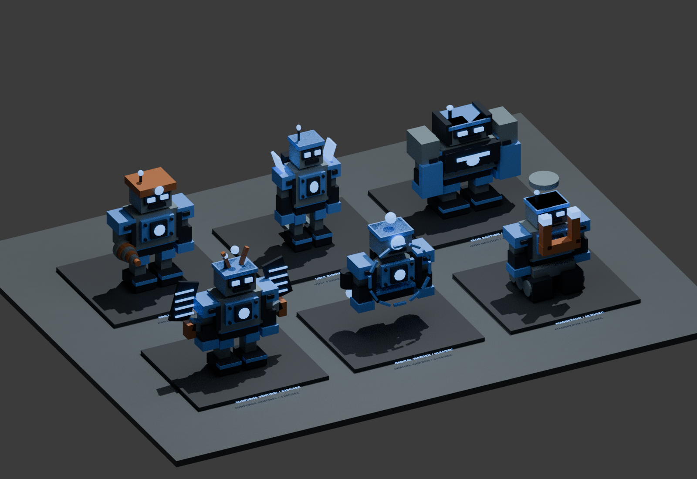

# v0.8 — rare server events and six recovered robot variants

Robot boxes are scarce server events. Everyone sees the actual box tier and
its district: **“A Rare Robot Box has spawned!”**. A Rare box guarantees a Rare
robot, with the exact model hidden until the final reveal.

## Event rules

First event: 60 seconds after server startup. Subsequent events: 240–420 seconds
apart. At most two boxes exist, including those carried. The first event uses
one of the first three districts; later events can use the entire yard.

There are 14 possible positions, with no crates scattered at startup. An
unclaimed ground box expires after 180 seconds. Held boxes cannot expire out of
a player's hands; dropping begins a fresh ground window. Delivery/expiry does
not bypass the event timer. A countdown, large announcement, known-tier label
and colored beacon help players find the box. Late joiners receive active
unclaimed events too.

| Box tier | Event weight |
|---|---:|
| Rare | 70% |
| Epic | 22% |
| Legendary | 6% |
| Mythic | 1.8% |
| Celestial | 0.2% |

## Robot models

| Variant | Visual identity | Rare income |
|---|---|---:|
| Iron Bastion | Broad armor, tower shoulders, shields | $80/sec |
| Volt Runner | Slim chassis, sprint fins, jet pods | $92/sec |
| Drillmaster | Drill arm, miner helmet and headlamp | $108/sec |
| Magnetron | Track base and large lifting magnet | $120/sec |
| Orbital Warden | Legless hover chassis, cyclops eye, orbital cage | $144/sec |
| Sunforge Sentinel | Solar wings, extra arms and crown | $180/sec |

Model weights are 30/24/20/14/9/3, with the immediately previous server-box
model excluded on the next draw. The server fixes the model at spawn; dropping
or resetting cannot change it. The tier is public; the model stays in the server
record until reveal. Crafted robots retain their original recipes and income.
Event robot income is round(tier recipe income × 4 × model multiplier), with
multipliers 1, 1.15, 1.35, 1.5, 1.8 and 2.25. Values are provisional game balance.

## Upgraded unboxing

Deliver to a free platform. The 5.6-second sequence builds energy, shakes the
carton, splits its tape and opens the flaps. Three-dimensional holograms cycle
during identification; orbiting energy arcs pulse around the platform. Carton
panels launch outward and fade before the actual model arrives with a turn,
scale bounce, particles, highlight and an owner-only name/income banner.
Holograms are presentation previews; only the final server result is awarded.
Income starts at the final reveal. Partial scrap projects remain untouched.

## Carry fix and validation

The user reported that v0.7 held the item overhead but left the avatar's arms
down. The new controller drives blended **C0 joint offsets** and neutralizes
Animator arm transforms after normal updates. Original offsets are restored
on drop, reset, death and removal. R6/R15 axis math and adapter lifecycle checks
pass. The real avatar from the screenshot still needs a Studio playtest; this
cloud environment cannot run Studio and cannot certify the visual result.

Automated tests also cover event intervals, expiry, live limits, announced
rarity guarantees, private variants, no fast ordinary respawn, payout consistency,
late-join state, capacity/ownership checks and duplicate recovery callbacks.
All Luau compiles and binary/XML places build. Actual GUI, unboxing timing,
streaming and mobile performance remain Studio/device checks.

## Geometry preview

This is a Blender render of shared geometry, **not a Studio screenshot**. All
six are shown at the same tier to make the model differences visible. Game
lighting, particles, animations and avatar posing require a playtest.
