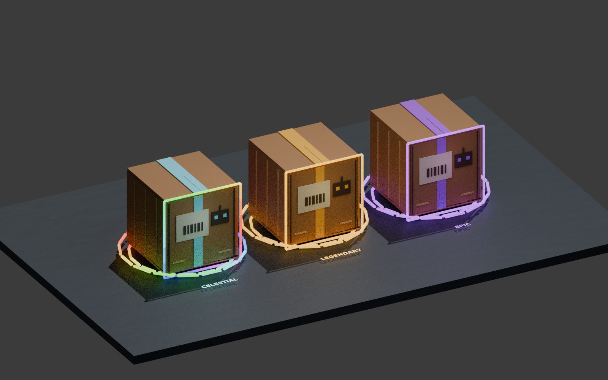
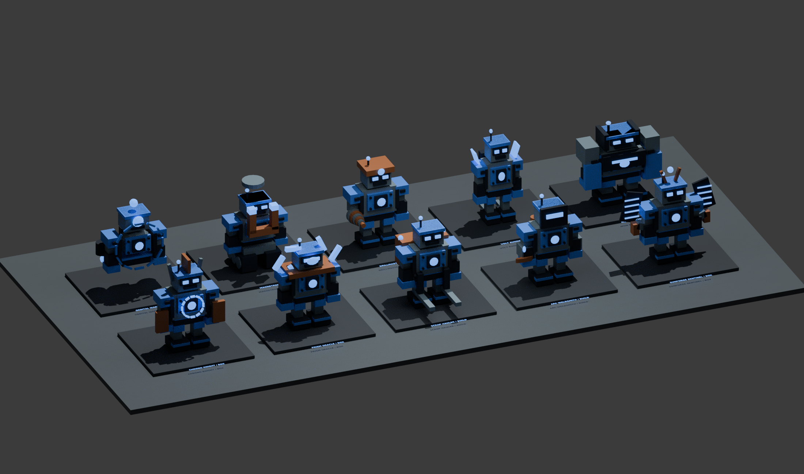

# Rarity effects and robot collection — v1.0

The seven rarity colors now come from one shared profile. Pickups, robot trim,
box tape/frames, recipe colors, announcements and opening effects use it.

| Rarity | Color | Box opening | Energy rings | Orbiting crystals |
|---|---|---:|---:|---:|
| Common | Silver `#B8C1CD` | No event | — | — |
| Uncommon | Green `#41E285` | No event | — | — |
| Rare | Blue `#4991FF` | 5.6 seconds | 2 | 4 |
| Epic | Purple `#B54DFF` | 7 seconds | 3 | 8 |
| Legendary | Gold `#FFBC2A` | 8 seconds | 4 | 12 |
| Mythic | Pink/red `#FF3E7D` | 9 seconds | 5 | 16 |
| Celestial | Animated RGB; cyan fallback | 10.5 seconds | 6 | 20 |

Epic+ pickups and boxes have nearby lights and drifting luminous particles.
Celestial has a moving rainbow along its 20-segment box border, animated index
and announcement borders, changing pickup/robot trim and rainbow opening rings,
crystals and captions. The effect is animated in Roblox; the asset render below
shows only one moment.

## Cinematic opening

Deposit a box at your own machine with a free platform. The server reserves
that platform and keeps the exact chassis private until the reveal. The box
charges and shakes, breaks its tape, opens its flaps, cycles eligible holograms
and launches its panels. Tilted 3D energy rings, orbiting crystals, a reactor
sphere and a reveal burst scale with rarity. Holograms are cosmetic previews.

Epic and above also use a close moving camera and local depth of field for the
owner. Nearby spectators see effects with their normal camera. **Space / Skip
Camera** (or controller B) restores the normal view immediately; the opening
continues and the reward is unchanged. Walking away, dying or finishing also
restores the camera, HUD, prompts and original field of view.

## Ten chassis per rarity

Ten original native-part chassis appear across seven rarities: **70 collection
entries**, using ten different model geometries with rarity-specific colors and
income. These are not 70 entirely different meshes.

| Chassis | Rare+ acquisition | Multiplier | Distinctive geometry |
|---|---|---:|---|
| Iron Bastion | Build only | 1.00× | Heavy armor and shoulder plates |
| Volt Runner | Build or box | 1.15× | Slim body and speed fins |
| Drillmaster | Build only | 1.35× | Drill arm and reinforced frame |
| Magnetron | Build or box | 1.50× | Tank drive and horseshoe magnet |
| Orbital Warden | Box only | 1.80× | Floating body and orbital cage |
| Sunforge Sentinel | Box only | 2.25× | Solar wings and extra arms |
| Arc Weldsmith | Build only | 1.25× | Welding visor, torch and gas tanks |
| Scrap Hauler | Build only | 1.40× | Cargo rack and loading forks |
| Prism Oracle | Box only | 2.00× | Floating crystals and oracle eye |
| Chrono Knight | Box only | 2.50× | Clock dial, shields and spires |

**Common/Uncommon:** all ten can be built. There are no Common/Uncommon box
events, so those tiers do not have unreachable box-only collection entries.

The two images are **Blender asset renders**, not Roblox Studio screenshots.
They share the native geometry; Roblox materials, lighting and animation differ.

## Discover, select and make room

1. Press **I** or choose **Details → Robot Index**. Cycle the rarity button to
   browse all seven tiers. Each row identifies Build, Box or Both and discovery.
2. Select a chassis and inspect its 3D preview and income. **Use for next build**
   selects an eligible blueprint without granting a robot. Box-only models
   cannot be selected as builds.
3. Deposit matching scrap. The first part locks the chassis for that project;
   changing the selection later applies to the next project of that rarity.
4. Finish the robot, or finish an actual box opening, to discover that entry.
5. At your own deposit machine, open **Your Platforms** and press **Retire**,
   then **Confirm Retire**, to remove a completed robot and free its platform.
   It gives no refund, stops that robot’s income and preserves its discovery.
   Partial builds and active openings cannot be retired.

Recipes remain 5/7/10/12/15/18/20 matching parts. Their base incomes are
$5/$10/$20/$45/$100/$225/$500 per second. Built income is rounded base × chassis
multiplier; boxed income is rounded base × 4 × chassis multiplier. For example,
Rare built Volt Runner earns $23/sec and boxed Volt Runner earns $92/sec.
The index shows the appropriate source incomes. Values remain test balance.

Natural box timing and tier odds are unchanged: first event after 60 seconds,
then 240–420 seconds apart; max two live boxes. Rare/Epic/Legendary/Mythic/
Celestial tier odds are 70/22/6/1.8/0.2%. Within a tier, only box-eligible
chassis can roll, with weighted chances and immediate repetition excluded.
Dropping, resetting or choosing a blueprint never rerolls a box.

## Verification and limits

All application Luau compiles; both binary/XML places build and contain every
source exactly once. Pure rules cover all 70 discoveries and acquisition routes.
Mocked actual-service checks cover server selection, private results, retirement,
income and a reveal whose slot shifts during another retirement. Client checks
cover rainbow progression, aura budgets and cinematic camera restoration.

At most eight nearby aura lights, twelve emitters and three local box stages
run. These budgets do not establish actual mobile FPS. Studio still needs the
[Windows playtest](STUDIO_START_SV.md), especially particles, camera collision,
input, streaming and mobile layout.

**Progress, discoveries, money and robots are session-only.** Character reset
preserves them in the server; leaving clears them. DataStore saving is not part
of this update.
