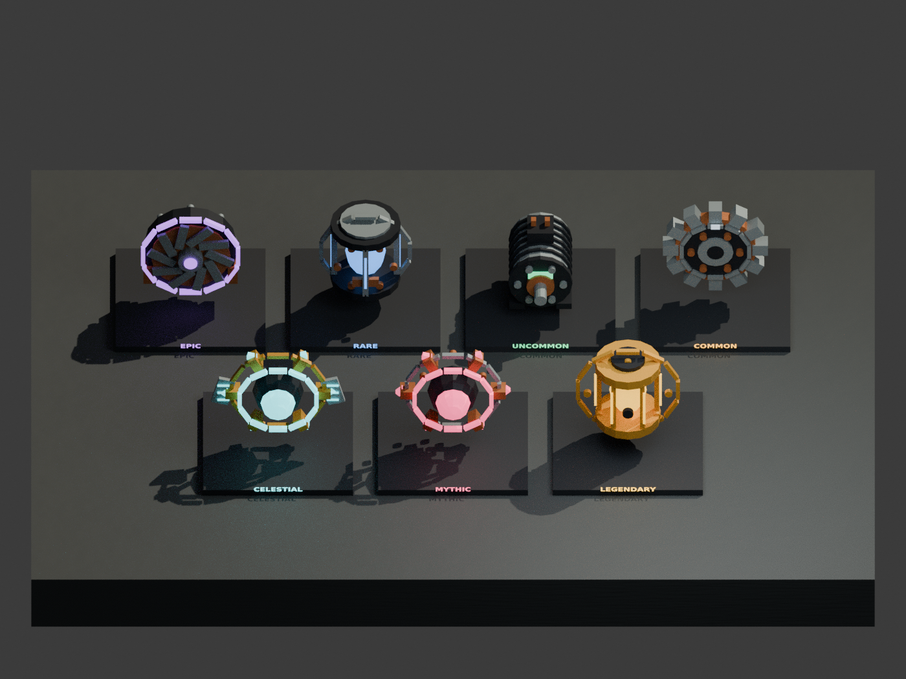
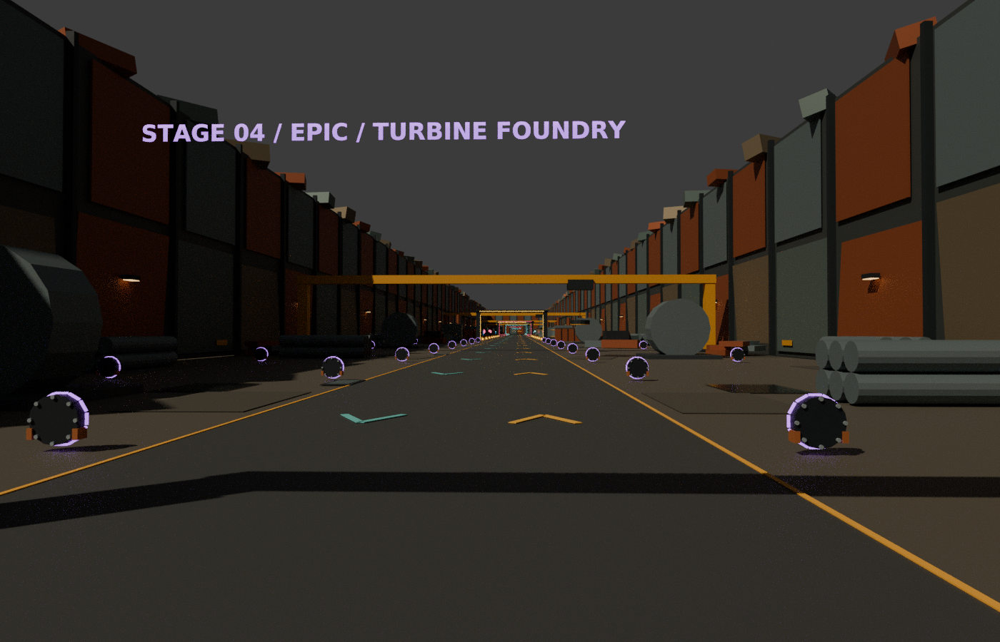
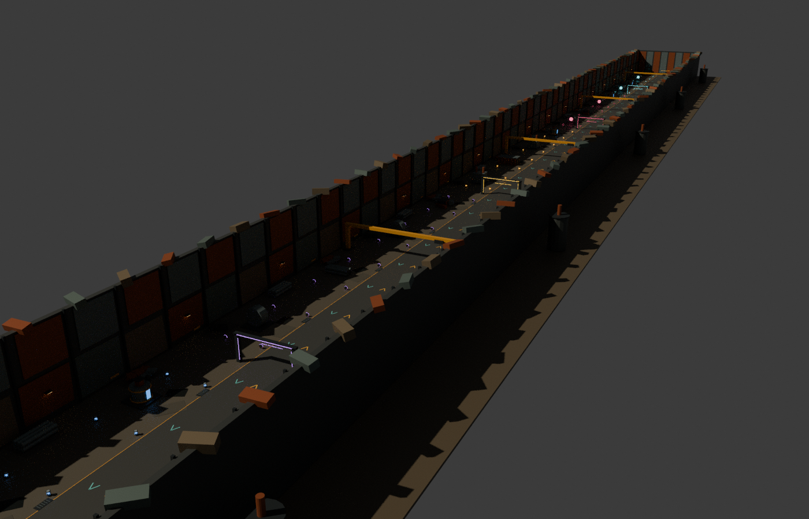

# v0.6 — seven stages, camera containment and animated salvage

The yard now measures **160 × 3360 studs**, with 32 pickups per stage (224 total).
All seven districts are open. Rarity terms follow familiar loot-game naming;
district names, models and animation code are original to this project.

| Stage | District | Collectible | Matching parts per robot | Income |
|---|---|---|---:|---:|
| Common | Sorting Yard | Gear | 5 | $5/sec |
| Uncommon | Machine Graveyard | Motor | 7 | $10/sec |
| Rare | Reactor Wrecks | Core | 10 | $20/sec |
| Epic | Turbine Foundry | Turbine | 12 | $45/sec |
| Legendary | Golden Furnace | Fusion Cell | 15 | $100/sec |
| Mythic | Void Salvage | Singularity | 18 | $225/sec |
| Celestial | Starforge Ruins | Star Engine | 20 | $500/sec |

New recipe amounts/income/weights are provisional balance. There are still four
robot platforms per player. Choose projects accordingly: recycling/replacing a
finished robot is not yet implemented. Progress remains session-only.

## Visual changes

- 64-stud scrap-clad walls around the yard and workshop plaza (previous long
  walls were 22). Structural walls and terrain use streamable 480-stud segments.
- Colored district gantries, large turbine wrecks, furnace grilles, broken field
  generators and star-engine cages give later areas distinct silhouettes.
- More detailed gears, motors and reactors; new turbine/fusion/singularity/star
  salvage, with machined rims, bolts, cooling fins, windings and energy accents.
- Resting pickups bob gently, slowly rotate and tilt above a pulsing ground halo.
  Their visual rig stops on pickup and resumes on drop. Prompts and server
  interaction coordinates stay stable.
- Recipe HUD scrolls through all tiers and follows the current district once
  on entry, keeping the mobile panel compact.

## Camera behavior

The normal orbit camera stays inside the connected plaza/yard, with padding for
its near plane and wide screens. Zoom is capped at 32 studs. Containment runs
after Roblox's standard camera and does not rely on wall parts being streamed
in. The entrance's narrower corners, rear wall and far wall are covered.
Mouse, touch, gamepad and first-person controls retain the default camera logic.
Scriptable cinematic cameras are deliberately outside this controller's scope.
Actual input feel and engine occlusion still require Studio testing.

## Budget and checks

The static blueprint has **3,134 parts** (budget 3,800) and **63 ambient sources**.
Each pickup has **42–60 parts including its carrier, pivot and 12 halo segments**
(budget 64). Tiny details and neon pieces do not cast shadows. Nearby-only local
animation uses a 110-stud activation distance and checks proximity every 0.2
seconds. Streaming and owner-pinned workshops remain enabled. These controls
are not measured FPS claims.

Automated checks cover all seven recipes and published progress, bounded camera
positions and continuous paths at corners/entrances, model clearance throughout
idle poses, spawn accessibility, part limits, carry/drop animation, distance
culling, streaming cleanup and existing purchases/income. All sources compile
and binary/XML places build. Roblox Studio is unavailable in this environment;
real multiplayer, input, lighting and mobile performance still need testing.

## Asset previews

These are Blender renders of shared geometry, **not Studio screenshots**. The
preview uses approximate materials, lighting and display poses. Native Roblox
lighting, particles, camera controls and animated joints require a playtest.
