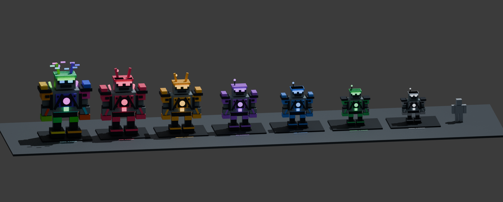

# Stage Guardians — v1.5

This release continues from the user's uploaded **v1.4 place**. Its 84 embedded
sources were recovered with their original hierarchy and committed separately
before guardian changes. The original file remains in `downloads`.

## One robot for each rarity district

The old ten flying security drones across Epic+ are replaced by **seven walking
guardians**, one in every district. Their original industrial robot bodies use
rarity-colored armor and six animated groups: torso, head, arms and legs. Higher
tiers add armor, exhaust stacks, crown details, reactor fins and an RGB halo.

| District rarity | Guardian | Approx. model height | Patrol speed | Chase speed | Warning |
|---|---|---:|---:|---:|---:|
| Common | Rustyard Watcher | 8.4 studs | 6 | 15 | 1.4s |
| Uncommon | Scrap Bruiser | 9.7 studs | 7 | 17 | 1.3s |
| Rare | Core Warden | 11.0 studs | 8 | 19 | 1.2s |
| Epic | Turbine Enforcer | 12.3 studs | 9 | 22 | 1.1s |
| Legendary | Gilded Colossus | 14.3 studs | 10 | 25 | 1.0s |
| Mythic | Void Reaper | 16.1 studs | 11 | 28 | 0.9s |
| Celestial | Astral Sentinel | 17.9 studs | 12 | 31 | 0.8s |

Speeds are **studs per second**. Heights are static blueprint bounds before
walking animation, excluding floating labels. All are provisional game balance.
Edit `Config.Guardians.Profiles` to tune them after Studio tests.

This is a **Blender geometry render**, not a Roblox Studio screenshot. The
Celestial colors show one moment of the animated spectrum.

## Theft and pursuit

- Empty-handed players may explore safely. A guardian detects only carriers of
  loot originating in its own district: normal scrap's spawn zone or a box's
  event location. Higher-tier loot carried through another district is ignored.
- Detection range increases from 48 to 92 studs. Solid scenery blocks spotting.
- Detection stops the patrol and shows a warning, red eyes, alarm light and the
  existing sound/banner. Pursuit starts after the tier's warning delay.
- A chase lasts 7–10 seconds, followed by eight seconds of cooling down. Upgrades,
  cover, dropping loot and escaping the district provide different escape routes.
- Guardians never leave their own district or enter the workshop plaza. Stage
  seams have one owner. A carrier outside the district cannot be confiscated.
- Catch distance scales with the body footprint. A clear line is required, so a
  robot cannot confiscate through solid scenery. Only the carried item resets
  through the existing CarryService path. Banked cash, robots and Robotdex stay.
- Death, disconnect and dropping end a chase without granting an Escape quest.
  Actually escaping with the protected loot, or surviving the chase timer with
  it, still progresses the existing daily Escape objective.
- There are no extra enemy spawns, combat, player damage or new currencies.

## Reference and limits of comparison

The user identified [Steal An Egg](https://www.roblox.com/games/107778070777162/Steal-An-Egg)
(place 107778070777162). Its public Roblox page was fetched successfully. It
describes stealing eggs from pets, hatching earners, upgrading a base and
training Speed on a treadmill. The public description does **not** publish guard
movement speeds or model dimensions. Search APIs were blocked in this cloud
environment, its thumbnail could not be downloaded, and Roblox gameplay cannot
be launched here. No gameplay timing or size measurements were obtained.

Therefore these are our own adjustable robot sizes and speeds for a similar
risk/progression loop; they are **not asserted to match measured Steal An Egg
values**. No code, models or other assets were extracted from that game.

## Implementation and verification

`GuardianRules` owns boundaries, loot origin, catch radius and patrol waypoints.
`GuardianNavigation` builds static eight-stud grids from the actual yard's
collidable geometry, including rotated bounds and height clearance. Components
and A* routes avoid blocked regions. Line-tested smoothing keeps complete route
segments clear. When a large body cannot reach a narrow loot gap, it approaches
only a safe reachable position. There is no jumping or intentional clipping.

`GuardianBuilder` supplies seven atomic, noncolliding motor rigs. Server
`SecurityService` resolves ownership, selection, warnings, movement, cooldowns,
catches and escape callbacks at 20Hz. Movement after a server stall is capped
to 0.15 seconds per step. Only movement/rendering state is replicated; clients
cannot request catches or target selection. Existing DroneChase / DroneAlert /
DroneCatch / DroneLost names remain internal compatibility channels for v1.4's
UI, audio and quests. Player-facing warnings now say guardian.

`GuardianAnimator` poses nearby rigs within 175 studs, resets poses at distance
and removes streamed-out instances/connections. No uploaded animation is needed.
The rest of v1.4's progression, DataStore name/schema, carrying and audiovisual
systems are retained.

`python3 scripts/check.py` checks:

- Seven profiles, all model bounds, stage boundaries, source rules, and complete
  patrol/representative loot routes against actual scenery.
- Actual server/builder/client adapter behavior across mocked engine boundaries:
  one per stage, warning, catches, drop/death/disconnect, region exit, timeout,
  foreign loot, ownership, wall occlusion, lag movement cap and cleanup.
- Imported 61-species acquisition pools, model generation, income/save round
  trips, mutations, rebirth preservation and daily quest rules.
- Actual SaveService persistence and offline fallback across a simulated store;
  compatible inventory, upgrades, yard checks and cinematic camera lifecycle.
- Compilation of all 89 application sources and exact source inclusion in both
  binary and XML place builds, still using only two RemoteEvents.

Older tests with superseded four-slot/70-entry/old-plaza expectations are
preserved in `tests/legacy-v1.0` and three old service helpers in
`scripts/legacy-v1.0`; they are explicitly excluded from the current command.
They were not counted as passing current tests. Claude's original tests were not
included in the uploaded place.

This is not a real Studio playtest. Native motor animation, streaming behavior,
actual catch feel, navigation startup time, DataStore API access and mobile FPS
need the [Windows test guide](STUDIO_START_SV.md).
