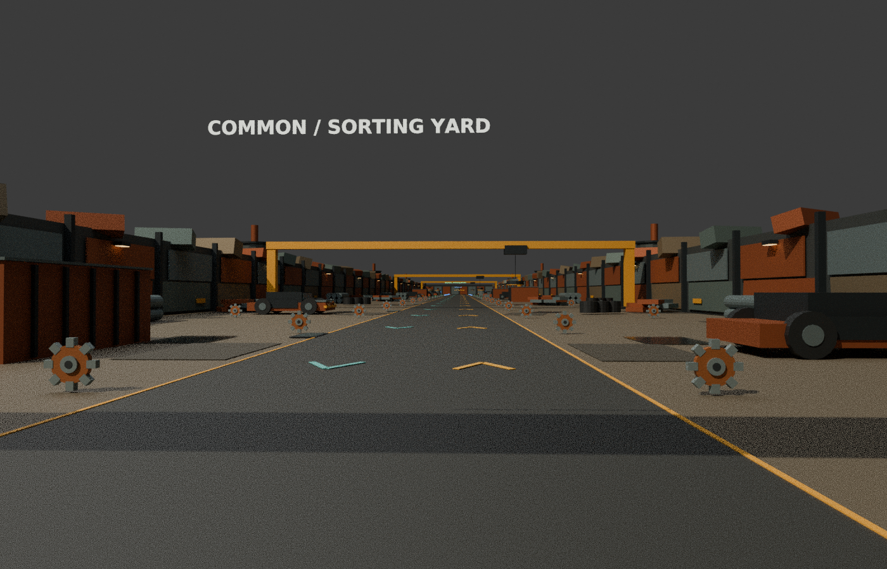
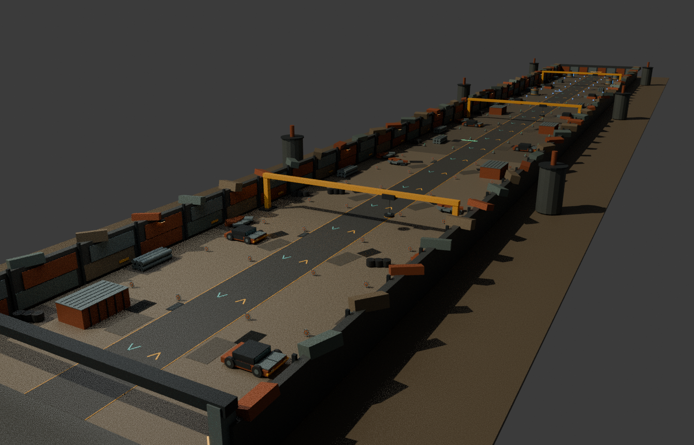
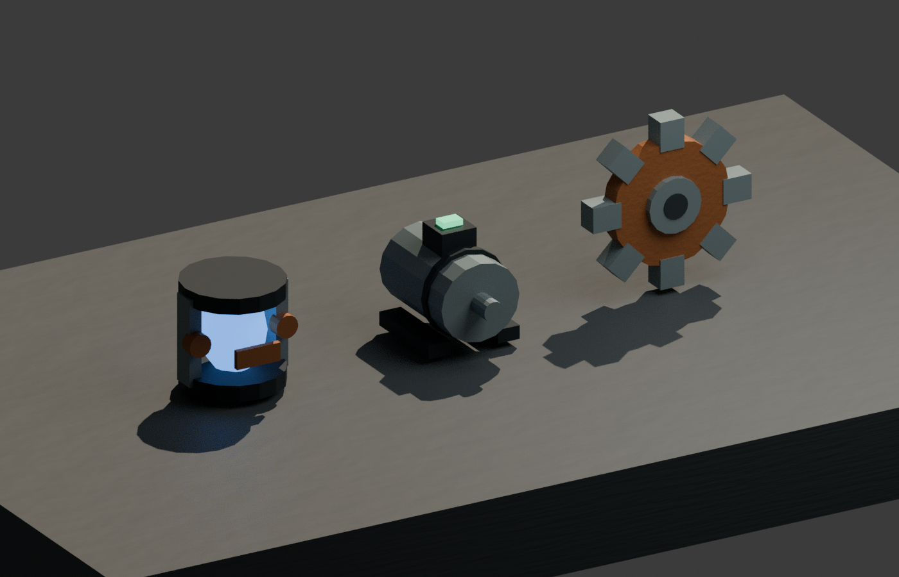

# Catch the Scrap v0.5 – industrial scrapyard visual pass

1. Open [Catch-the-scrap-v0.5.rbxl](Catch-the-scrap-v0.5.rbxl) on GitHub.
2. Click **Download raw file** (the down-arrow button).
3. Stop the old Studio test. Open this new file using **File → Open from File / Ctrl+O**.
4. Press **Play / F5**. The world is constructed at startup.

## The new visual pass

Scrap-clad perimeter walls, reinforced entrances, silos, layered weathered panels,
vehicle and machine details, stained ground, drains and warm work lights make
the 160 × 1440-stud yard feel like an industrial salvage site. Workshops, robots
and Milo's stand have extra mechanical details. Collectibles now look like gears,
motors and clamped reactor cores. Lighting uses a late-afternoon atmosphere,
clouds and restrained bloom, with nearby-only ambient lights, smoke and sparks.

The world streams in sections. Your own workshop remains loaded for you. Test
returning from the far end and resetting your character in the new place file.

**WASD** move · **Hold E** pick up/deposit/browse · **Q** drop · **X** close shop.
All custom in-game text is English. Milo sells Speed and Strength upgrades with
earned cash. Common robots need 5 matching parts, Uncommon 7, Rare 10. Upgrades,
robots and money are session-only; permanent saving is not implemented.

[Windows test guide (Swedish)](../docs/STUDIO_START_SV.md) · [Editable source ZIP](Catch-the-scrap-v0.5-source.zip) · [Visual review](../docs/VISUAL_PASS_V05.md)

These are Blender asset renders using shared geometry, **not Roblox Studio
screenshots**. Native lighting, materials, text and particles differ. Automated
checks and builds passed; actual Studio interaction, streaming, lighting and
device performance still need testing. Older versioned downloads are archives.
