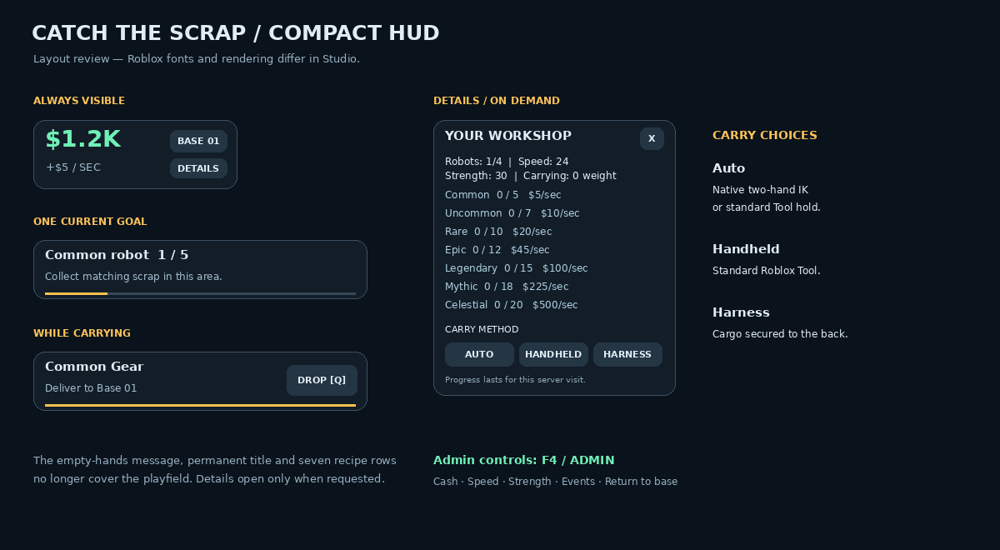

# Catch the Scrap v0.9

1. Download [Catch-the-scrap-v0.9.rbxl](Catch-the-scrap-v0.9.rbxl) with **Download raw file**.
2. Stop the old Studio test. Open this file with **Ctrl+O**, then **Play / F5**.
3. Use **Details** for carry choices and recipes. Use **F4 / Admin** for test tools.

Carrying is rebuilt around native two-hand IK/Tool hold, with a body-mounted
harness alternative. The large left panel is replaced by a compact wallet and
one current goal. Initial and replacement scrap positions are randomized safely
inside each rarity district, away from the previous position and obstacles.

Admin is configured for **11824623188**, local Studio testing and the personal
experience owner. It can set/add personal cash, set speed/strength, reset test
stats, return home and trigger existing box events. Server validation protects
all commands. Gameplay, cash and admin changes remain session-only.

[Windows guide (Swedish)](../docs/STUDIO_START_SV.md) · [Rework details](../docs/REWORK_V09.md) · [Editable source ZIP](Catch-the-scrap-v0.9-source.zip)

The image is a layout review, **not a Studio screenshot**. Automated checks and
builds pass; actual avatars, native carry/GUI behavior and device performance
still need Studio testing. Older downloads are archived builds.
