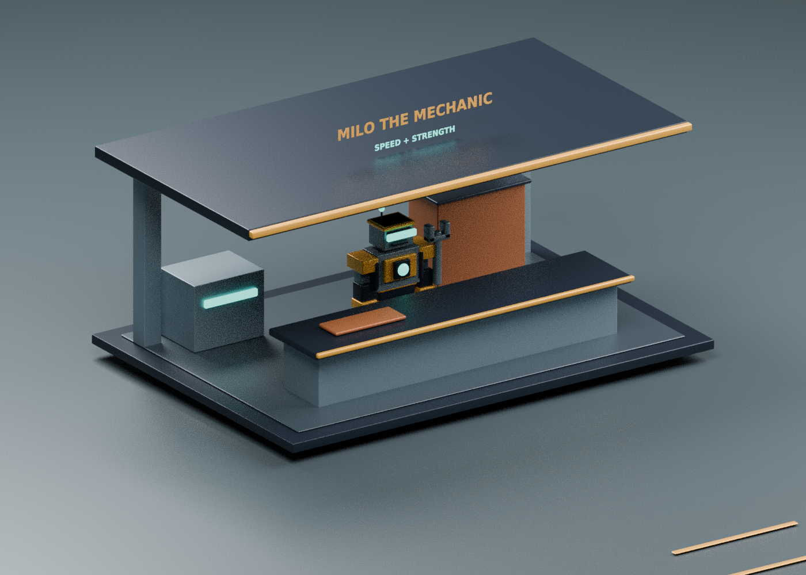

# Catch the Scrap v0.4 – Milo the Mechanic

1. Open [Catch-the-scrap-v0.4.rbxl](Catch-the-scrap-v0.4.rbxl) on GitHub.
2. Click **Download raw file** (the down-arrow button).
3. Stop the old Studio test, open the new file with **File → Open from File / Ctrl+O**, and press **Play / F5**.

Visit **Milo the Mechanic**, the small robot service stand beside the scrapyard
entrance. Hold **E / Browse upgrades** to see your cash, current levels, next
stat values and prices. Buy with cash earned by your production robots.

| Upgrade | Effect per level | First price | Cap |
|---|---:|---:|---:|
| Speed | +2 base speed | $75 | 10 levels |
| Strength | +10 carrying strength | $100 | 10 levels |

Prices increase after each purchase. Speed affects both unloaded and loaded
movement. Strength reduces the weight penalty. Purchases apply immediately,
including while carrying, and survive character reset during the same server
visit. All progress, including upgrades, resets when leaving the server.

Stand near Milo to buy. Walking away closes the menu. The server checks prices,
cash, distance, liveness, caps, stale offers and purchase cooldowns.

**WASD** move · **Hold E** pick up/deposit/browse · **Q** drop · **X** close shop.
The three-zone scrapyard and robot recipes remain: Common 5 matching parts,
Uncommon 7, Rare 10. Four production platforms per player.

[Windows guide in Swedish](../docs/STUDIO_START_SV.md) · [Editable source ZIP](Catch-the-scrap-v0.4-source.zip)

This is a Blender asset render using the shared geometry, not a Roblox Studio
screenshot. Automated logic/service checks and place builds passed. Actual
Studio interaction, menu layout, mobile input and multiplayer still need testing.
Older versioned downloads are archived builds; use v0.4 for the mechanic shop.
